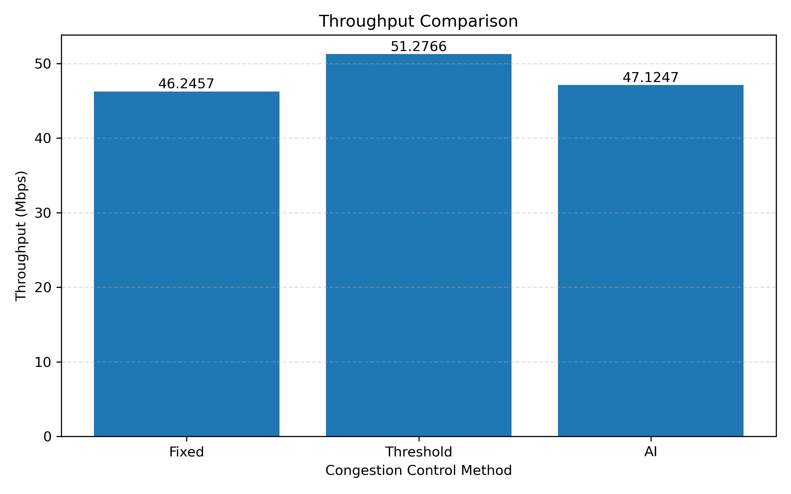
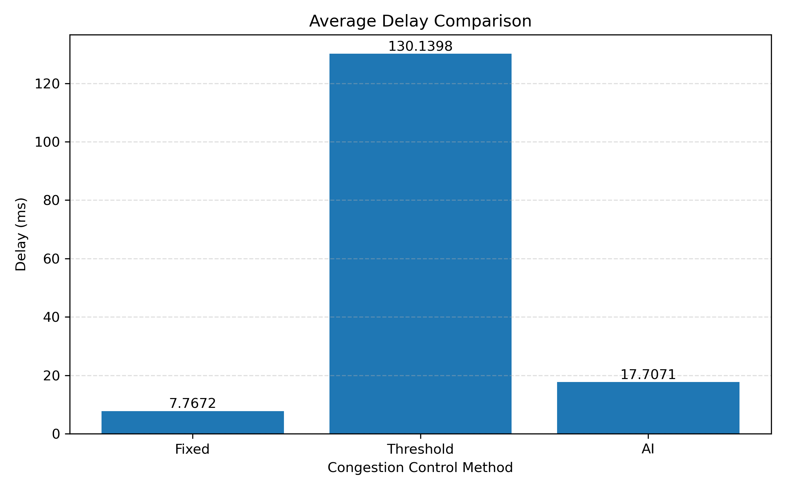
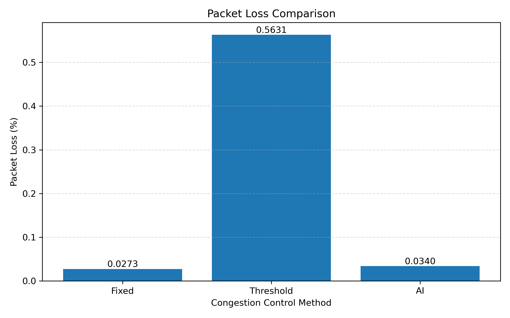
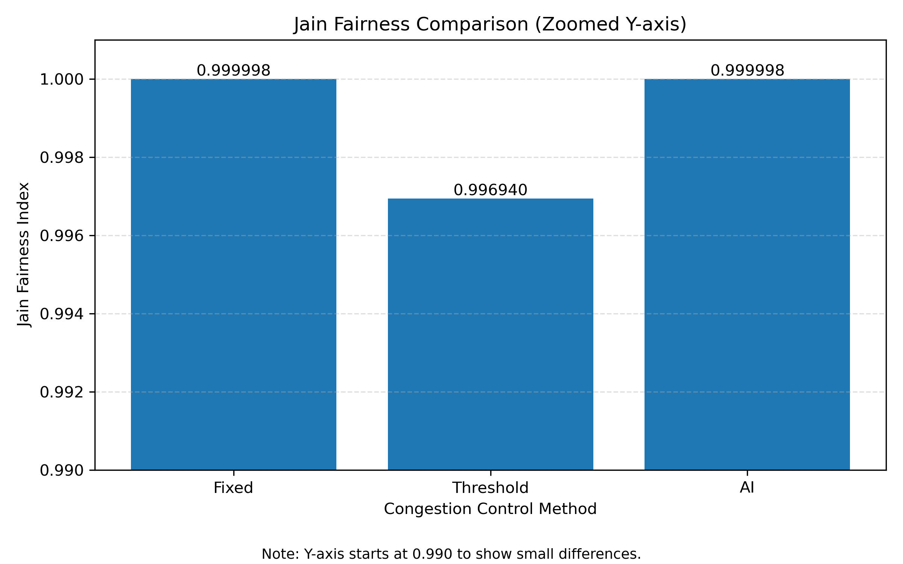

# AI-Based Congestion Control for Wireless Networks

An intelligent wireless congestion-control system that uses **Machine Learning and ns-3 simulation** to detect network congestion and dynamically adjust transmission rates.

## 1. Project Overview

This project implements an AI-based congestion-control mechanism for wireless networks. It uses a Random Forest classifier to predict congestion based on network transmission rate and throughput.

The simulation consists of three wireless senders communicating with one receiver. Based on the model's prediction, the controller dynamically adjusts each sender's transmission rate to manage congestion.

The system is implemented using ns-3, Python, Flask and React.

## 2. System Architecture

1. **Network Simulation:** ns-3 generates wireless network traffic.
2. **Data Collection:** Network measurements are collected and stored in CSV files.
3. **ML Prediction:** A Random Forest model predicts whether the network is NORMAL or CONGESTED.
4. **Adaptive Control:** The controller adjusts the transmission rate based on the prediction.
5. **Backend:** Flask provides APIs for network results.
6. **Dashboard:** React displays network metrics and comparison charts.

## 3. Technologies Used

- C++ and ns-3.46.1
- Python
- Scikit-learn
- Pandas and NumPy
- Flask and Flask-CORS
- React and Vite
- JavaScript

## 4. Machine Learning Model

A Random Forest Classifier is trained using data collected from ns-3 wireless simulations.

| Parameter | Description |
|---|---|
| Dataset records | 2,640 |
| Input features | Transmission rate and throughput |
| Target | Congestion status |
| Algorithm | Random Forest Classifier |
| Number of trees | 200 |
| Maximum depth | 8 |
| Test accuracy | 99.05% |

**Input features:**
- `Rate_Mbps`
- `Throughput_Mbps`

**Congestion classification:**

A sample is labelled CONGESTED when its average delay exceeds 100 ms. Otherwise, it is labelled NORMAL.

The dataset is divided into training and testing sets using simulation-seed-based grouping to keep records from the same simulation seed together.

The reported accuracy is measured on held-out simulated data. It does not represent guaranteed accuracy in real-world wireless networks.

## 5. AI-Based Congestion Control

The controller uses the model's prediction to adjust the transmission rate.

| Prediction | Controller action |
|---|---|
| NORMAL (0) | Increase rate by 1 Mbps |
| CONGESTED (1) | Reduce rate by 30% |

The rate is bounded between 1 Mbps and 30 Mbps.

A persistent Python prediction worker is used in the main AI simulation. It loads the trained model once and handles multiple prediction requests instead of starting a new Python process for every prediction.

## 6. Experimental Comparison

The proposed AI controller is compared with two approaches:

- **Fixed Rate:** Transmission rate remains constant.
- **Threshold-Based:** Congestion control uses a fixed threshold.
- **AI Adaptive:** A Random Forest model predicts congestion and adjusts transmission rates.

The following values are averages across five simulation runs.

| Metric | Fixed Rate | Threshold-Based | AI Adaptive |
|---|---:|---:|---:|
| Throughput (Mbps) | 46.245700 | 51.276580 | 47.124740 |
| Average Delay (ms) | 7.767222 | 130.139780 | 17.707120 |
| Packet Loss (%) | 0.027308 | 0.563143 | 0.033982 |
| Jain Fairness | 0.999998 | 0.996940 | 0.999998 |

### Results Interpretation

- AI Adaptive achieves higher throughput than Fixed Rate, although it is lower than Threshold-Based.
- AI Adaptive has considerably lower delay and packet loss than Threshold-Based.
- Fixed Rate has the lowest average delay and packet loss in these experiments.
- AI Adaptive achieves fairness close to Fixed Rate.

These results indicate that the AI controller provides a balance between throughput, delay, packet loss and fairness rather than achieving the best value in every metric.

### Measurement Windows

For consistency, throughput and Jain fairness are measured over a common simulation window from 2 to 10 seconds.

Average delay and packet loss are calculated using whole-simulation FlowMonitor statistics. Therefore, these metrics use different measurement windows.

### Performance Graphs

**Throughput Comparison**



**Average Delay Comparison**



**Packet Loss Comparison**



**Jain Fairness Comparison**



The fairness graph uses a zoomed vertical axis starting at 0.990 to make small differences visible.

## 7. Prediction Execution Optimization

The original prediction approach started a separate Python process and loaded the model for every prediction request.

This introduced significant execution overhead.

A persistent worker-based approach was implemented:

- Starts one Python worker.
- Loads the trained model once.
- Handles multiple prediction requests through standard input and output.
- Shuts down cleanly after the simulation.

In the tested main AI simulation:

| Parameter | Original | Optimized |
|---|---:|---:|
| Runtime | 1098.32 seconds | 21.79 seconds |
| Python worker launches | 27 | 1 |
| Model loads | 27 | 1 |
| Predictions | 27 | 27 |

The optimized implementation achieved approximately **50.4× faster execution** in this experiment.

Prediction equivalence was checked, and the simulation output hash remained unchanged:

`CA054DA3B4DD1F9ED8C6AD6BA52E9A987DAE020E02CCC8E9EFF0D8CD1F47EAE8`

These measurements apply to the tested main AI simulation, not every simulation program in the project.

See `OPTIMIZATION_REPORT.md` for implementation and validation details.

## 8. Project Structure

```text
AI-Based-Wireless-Congestion-Control/
│
├── scratch/
│   ├── ai-congestion-control.cc
│   ├── comparison.cc
│   ├── window-dataset.cc
│   └── wireless-baseline.cc
│
├── dashboard/
│
├── train_model.py
├── predict.py
├── predict_worker.py
├── verify_prediction_equivalence.py
├── congestion_model.pkl
│
├── app.py
├── window-results.csv
├── wireless-results.csv
├── ai-control-results.csv
│
├── comparison-results-all-runs.csv
├── comparison-average-results.csv
├── comparison-results-validated-run-*.csv
├── comparison-results-window-details-run-*.csv
│
├── generate_graphs.py
├── throughput_comparison.png
├── delay_comparison.png
├── packet_loss_comparison.png
├── fairness_comparison.png
│
├── OPTIMIZATION_REPORT.md
└── README.md
```

## 9. Running the Project

The ns-3 simulation programs must be run from the ns-3.46.1 directory.

### Run the AI congestion-control simulation

```bash
source .venv/bin/activate
./ns3 run scratch/ai-congestion-control
```

### Run the comparison simulation

```bash
./ns3 run scratch/comparison
```

### Start the Flask backend

From the project directory:

```bash
source .venv/bin/activate
python app.py
```

### Start the React dashboard

Open another terminal:

```bash
cd dashboard
npm install
npm run dev
```

Open the dashboard in your browser:

http://localhost:5173/

## 10. Limitations

- Experiments are conducted using a simulated wireless network.
- Model accuracy on simulated data does not establish real-world accuracy.
- The current model uses only transmission rate and throughput as input features.
- Evaluation is limited to the tested network topology and traffic conditions.
- Further testing is required with larger networks and different wireless environments.

## 11. Future Improvements

- Evaluate additional network topologies and traffic patterns.
- Include more network measurements as ML input features.
- Compare additional machine learning algorithms.
- Study performance under different wireless channel conditions.
- Explore deployment in real wireless environments.

## 12. Project Goal

The main objective is to explore how machine learning can assist wireless congestion control by predicting congestion and adapting transmission rates based on observed network conditions.